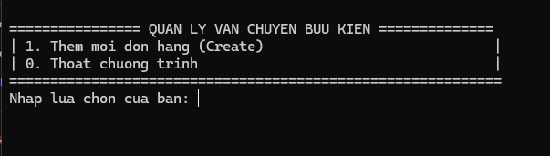
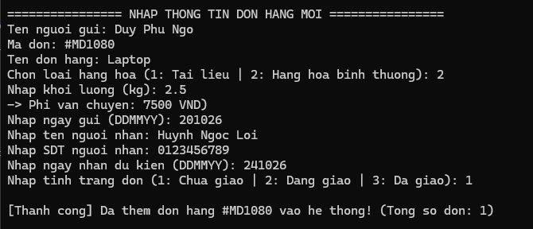

# Quản Lý Thông Tin Kiện Hàng 📦

> **Dự án cuối khóa:** Chương trình Đào tạo Ngôn ngữ Lập trình C  
> **Giao diện:** Console Application (Dòng lệnh)

Dự án được thực hiện nhằm mô phỏng giải pháp quản lý, lưu trữ và xử lý thông tin các bưu kiện/hàng hóa thực tế. Phần mềm hỗ trợ tối ưu hóa quy trình phân loại đơn hàng cho các đơn vị vận chuyển.

---

## 💡 Điểm Nổi Bật Kỹ Thuật

* **Sử dụng cấu trúc dữ liệu `struct`:** Toàn bộ thông tin đơn hàng (mã đơn, tên người nhận, trọng lượng, địa chỉ, trạng thái, phí vận chuyển,...) được đóng gói và quản lý bằng `struct` trong C.
* **Tương tác Console:** Giao diện điều khiển dạng menu lựa chọn trên màn hình đen (Console UI), trực quan và dễ sử dụng.

---

## 🌟 Tính Năng Chính

Chương trình cung cấp menu tương tác console đầy đủ các chức năng quản lý:

* ➕ **Thêm đơn hàng:** Nhập và lưu trữ thông tin kiện hàng mới vào danh sách `struct`.
* 📋 **Hiển thị danh sách:** Xuất bảng danh sách toàn bộ các đơn hàng hiện có dưới dạng lưới trên console.
* 🔍 **Tìm kiếm đơn hàng:** Tra cứu nhanh đơn hàng theo mã đơn hoặc tên người nhận.
* ✏️ **Sửa thông tin:** Cập nhật lại chi tiết bưu kiện khi có thay đổi.
* 🗑️ **Xóa đơn hàng:** Loại bỏ các đơn hàng đã hủy hoặc nhập sai khỏi hệ thống.
* 💰 **Tính phí vận chuyển:** Tự động tính toán số tiền cước dựa trên trọng lượng/kích thước kiện hàng.
* 🏷️ **Lọc đơn hàng:** Phân loại và hiển thị riêng danh sách đơn **Đã giao** và **Chưa giao**.

---

## 🛠️ Công Nghệ & Trình Biên Dịch

* **Ngôn ngữ:** C (Standard C)
* **Khái niệm cốt lõi:** `struct`, Mảng/Danh sách liên kết, Con trỏ (Pointers), Hàm (Functions).
* **Trình biên dịch khuyến nghị:** GCC (MinGW / Clang) hoặc các IDE như Code::Blocks, Dev-C++, Visual Studio Code.

---

## 🚀 Hướng Dẫn Biên Dịch & Chạy Chương Trình

### 1. Tiền đề
Máy tính của bạn cần sẵn sàng trình biên dịch C (như GCC) hoặc một IDE lập trình C bất kỳ.

### 2. Các bước thực hiện qua Terminal / Command Prompt

1. **Mở Terminal/CMD** và di chuyển tới thư mục chứa mã nguồn:
   ```bash
   cd /duong-dan-den-thu-muc-du-an
   ```

2. **Biên dịch mã nguồn C:**
   ```bash
   gcc main.cpp -o main
   ```

3. **Khởi chạy ứng dụng Console:**
   * Trên **Windows**:
     ```bash
     main.exe
     ```
   * Trên **Linux / macOS**:
     ```bash
     ./main
     ```

---

## 📝 Yêu Cầu Đồ Án / Bài Tập
* Môn học: Lập trình C cơ bản & nâng cao
* Yêu cầu thực tế: Ứng dụng `struct` để giải quyết bài toán quản lý kiện hàng thực tế trên giao diện Console.

---

##  Ảnh Demo

* Màn hình `main`



* Màn hình `Create`


